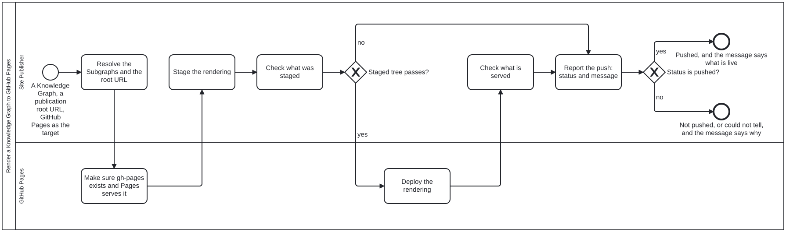


<!-- Generated by the bootstrap toolset (https://github.com/litlfred/bootstrap-tools, scripts/readme-book.ts) from every README in this repository — do not edit; edit a README instead. -->
> *This page was generated by [bootstrap-tools](https://github.com/litlfred/bootstrap-tools) — [`scripts/readme-book.ts`](https://github.com/litlfred/bootstrap-tools/blob/main/scripts/readme-book.ts), from every README in this repository. Do not edit it here; edit a README instead.*

# Bootstrap tools

The Zod source of bootstrap's schemas, the generators that write bootstrap's JSON Schemas, schema page and READMEs, and the checks bootstrap's content must pass — runnable by an agent, with zod, liquidjs, Playwright and bpmn-js as its dependencies.

*Every README in this repository on one page: the root's first, then each directory's, in path order.*

## Contents

1. [bootstrap-tools](#readme) — `README.md`
   - [What is here](#readme--what-is-here)
   - [Running it](#readme--running-it)
   - [The site](#readme--the-site)
   - [Rendering a Knowledge Graph to GitHub Pages](#readme--rendering-a-knowledge-graph-to-github-pages)
   - [Status](#readme--status)
2. [The toolset's Processes](#processes) — `processes/README.md`
3. [The toolset's Roles](#scenarios) — `scenarios/README.md`
4. [Bootstrap's shapes, in Zod](#schemas) — `schemas/README.md`
5. [The tools](#scripts) — `scripts/README.md`
6. [The toolset's skills](#skills) — `skills/README.md`

---

## <a id="readme"></a>bootstrap-tools

*From [`README.md`](README.md).*

**The toolset that describes [`bootstrap`](https://github.com/litlfred/bootstrap), kept outside it so bootstrap does not have one.**

Bootstrap is a content Knowledge Graph: files to read (`.md`, `.json`, `.bpmn`) and nothing to run. Its README promises an agent that it needs nothing installed. So the code that writes bootstrap's schemas and checks its content lives here, beside it, and bootstrap never imports from here.

It is **one** toolset over swappable content. Someone who wants a different generator, visualiser or checker uses a different toolset against the same bootstrap.

**Contents**

<!-- kg:toc:begin -->

<!-- Generated by the bootstrap toolset (https://github.com/litlfred/bootstrap-tools, scripts/readme-sections.ts) from this README's own headings (section `kg:toc`) — do not edit; edit outside the markers, or change what it is generated from. -->
> *This section was generated by [bootstrap-tools](https://github.com/litlfred/bootstrap-tools) — [`scripts/readme-sections.ts`](https://github.com/litlfred/bootstrap-tools/blob/main/scripts/readme-sections.ts), from this README's own headings (section `kg:toc`). Do not edit it here; edit outside the markers, or change what it is generated from.*

- [What is here](#readme--what-is-here)
- [Running it](#readme--running-it)
- [The site](#readme--the-site)
- [Rendering a Knowledge Graph to GitHub Pages](#readme--rendering-a-knowledge-graph-to-github-pages)
  - [Roles](#readme--roles)
- [Status](#readme--status)

<!-- kg:toc:end -->

### <a id="readme--what-is-here"></a>What is here

| path | what it is |
|---|---|
| `schemas/graph.ts` | bootstrap's defined terms, in order, with what each uses and the schema that defines it; its graph typologies; the declaration shape |
| `schemas/discussion.ts`, `requirement.ts`, `requirement-set.ts`, `model-registry.ts` | the Zod source of the other schemas bootstrap publishes |
| `schemas/declaration.ts` | reads a Knowledge Graph declaration with bootstrap's own shape |
| `schemas/release-iri.ts` | a layer's release addresses: `<iriBase>v<major>/`, for programs and people alike (the exact release is the pin's) |
| `schemas/declared-order.ts` | checks that an authored order keeps its promise: each item uses only items above it |
| `scripts/gen-bootstrap-schemas.ts` | writes `bootstrap/schemas/*.schema.json` and the drawn page `bootstrap/schemas/README.md` |
| `scripts/gen-vocabulary.ts` | writes `bootstrap/ns.jsonld`, bootstrap's vocabulary: every defined term and graph typology, as RDF and SKOS, at the address its IRIs name |
| `scripts/export-graph.ts`, `schemas/graph-export.ts` | writes `<name>.jsonld`, a layer's own graph — bootstrap's, and this repository's — in bootstrap's classes and standard properties (Dublin Core, BPMN, PROV, FOAF); a Process carries its diagram's documentation, the processes it calls and its drawing. The site publishes it, nothing commits it |
| `scripts/subgraph-jsonld.ts`, `schemas/subgraph-export.ts` | a layer's named subgraphs, projected from that same graph: under `<root>subgraph/<name>/<path>/`, `index.jsonld` (each direct member a pointer, each child subgraph by IRI) and `index.hydrated.jsonld` (every node of the transitive membership inline); the instance root and the repository level (`<root>subgraph/`) have the index only, and every file names `<root>subgraph/v<major>/context.jsonld`. A Process carries its diagram's documentation (`summary`, `description`), the processes it calls, its `.bpmn` and its SVG. `site.ts` stages them for bootstrap and for this repository; `--check` validates a build |
| `scripts/bootstrap-schema-page.ts` | draws `bootstrap/schemas/README.md` from the published schemas: an ASCII class box per object, the conditional rules in words, a `[src]` link per term; written in the same run as the schemas |
| `scripts/validate-bootstrap.ts` | parses bootstrap's own documents (`models/models.json`, `bootstrap.json`, any discussion document) against their Zod (`bun run validate`) |
| `scripts/schema-semver.ts` | the bump bootstrap's published schemas require, computed from a diff of the generated documents (`bun run semver`); see [`skills/bootstrap-contract-semver.md`](skills/bootstrap-contract-semver.md) |
| `scripts/generated-by.ts` | the generated-by notice every file these tools write carries |
| `scripts/publish-files.ts` | publishes bootstrap's files as they sit at its site address, never overwriting; GitHub Pages renders the `.md` |
| `scripts/rehearse-standalone.ts` | runs these tools' checks and tests with bootstrap and bootstrap-tools copied alone as sibling clones, so nothing outside the two is read |
| `scripts/iri-sync.ts` | keeps every literal release IRI at the declared version |
| `scripts/term-links.ts` | links each defined term in README prose to its definition |
| `scripts/subgraph-readmes.ts`, `scripts/templates/readme/` | writes each declared directory's README from its declaration, through Liquid templates; standalone it writes only the graphs these tools `support` |
| `scripts/readme-graph-sections.ts` | the `kg:processes`, `kg:files` and `kg:roles` README sections: every Process drawn, every file described from itself, every Role with all its names |
| `scripts/readme-toc.ts` | the `kg:toc` README section: a README's own level-2 and level-3 headings, linked by GitHub's anchors, outside code and outside its own region |
| `scripts/readme-sections.ts` | writes (or with `--check`, verifies) every section a README opts into by its marker pair; `--root` names the layer |
| `scripts/readme-book.ts` | every README in a repository as one page: the root's first, then each directory's by path, with a table of contents, headings demoted per section and relative links rewritten; `--check` fails on any link on the page that would not land |
| `scripts/site.ts` | stages a layer's GitHub Pages site. First every JSON Schema and JSON-LD document at the IRI it names (`$id` / `@id` under `iriBase`, an extensionless one included, with a `.json` copy beside each JSON-LD), and for bootstrap, and any instance that needs it, its graph and named subgraphs. The README page as `README.md` (served at `README.html`), ending in a "Published documents" list; then its files as they sit, also under `v<major>/`; `index.html`, a redirect to `README.html` unless the instance brings its own landing page; and `_config.yml` with `_layouts/default.html`, whose footer links a generated page's generator and source rather than an edit page. `--check` stages into a temporary directory and lists every address |
| `scripts/publish-site.ts` | publishes a staged site onto a branch (default `gh-pages`) of any git remote as a full replace: clone fresh, replace every file, commit, push; a lost race retries from a fresh clone, an empty site is refused. Not tied to a CI system: an agent or a person runs `site.ts --out <dir>` then `publish-site.ts --site <dir> --remote <url>` with their own git credentials, which is all `pages.yml` does, and how bootstrap's site is published |
| `scripts/pages-status.ts` | the OUTPUT of rendering a Knowledge Graph to GitHub Pages: stages the site to check it, asks the publication root URL and every document address, and prints the push's status (`pushed`, `not-pushed`, `could-not-determine`) with one message naming the deployed commit and the QA result; `--json` for the whole record |
| `processes/render-kg-to-github-pages.bpmn`, `skills/render-kg-to-github-pages.md`, `scenarios/roles.json` | the toolset's own small content graph: the Process that renders a Knowledge Graph (or a list of its Subgraphs) to GitHub Pages at a publication root URL, the Skill with each step's command, and the two Roles its lanes bind |
| `scripts/init.ts` | walks a layer's initialization steps as its declarations name them. PRIMARY and first: `schemas:staged` and `schemas:published`, the JSON Schemas and JSON-LD at their IRIs. Then directories, assets, the README and its sections, needed harnesses' instructions and the Pages site. It performs what a tool can (switching Pages on needs an authenticated `gh`) and reports each as done, not done, could not determine, or stated. A 404 is not done; a 403, 407, 5xx or no answer could not be determined |
| `scripts/render-bpmn.ts` | draws each Process as an SVG beside its `.bpmn`, with bpmn-js in headless Chromium; the harness's site renderer uses the same drawing |
| `scripts/git-files.ts` | the files git accounts for — tracked, plus untracked and not ignored |
| `scripts/gate-own.ts` | whether a file is the caller's own in a layer's PR checks, read from the paths the layer PR-check runner sets; `iri:sync:check` judges only those, so another layer's stale copy is that layer's CI's to catch |
| `scripts/check-closure.ts` | fails if anything here imports beyond itself, `zod`, `liquidjs`, `@playwright/test` and the runtime. Its walk, `importClosure`, is the one import-closure walker: a harness's remote mount uses it to bring a chosen Tool with its code, and nothing writes a second |
| `scripts/check-node-iris.ts` | fails if a published node's identifier is not its file's path |
| `scripts/check-bootstrap-concepts.ts` | fails if a bootstrap schema, or the Zod it is generated from, names a concept from outside bootstrap |

### <a id="readme--running-it"></a>Running it

Every tool is a script an agent runs, as the actor in a process step, or a person runs by hand. None needs a service.

```sh
bun run --cwd bootstrap-tools schemas          # regenerate bootstrap's schemas and schema page
bun run --cwd bootstrap-tools readmes          # regenerate bootstrap's directory READMEs
bun run --cwd bootstrap-tools render           # redraw each Process beside its .bpmn
bun run --cwd bootstrap-tools vocabulary       # regenerate bootstrap/ns.jsonld
bun run --cwd bootstrap-tools graph -- --root ../bootstrap --base-url <site>/bootstrap/ --out bootstrap.jsonld
bun run --cwd bootstrap-tools subgraphs -- --root ../bootstrap --out ../_site-src   # named subgraphs, under subgraph/
bun run --cwd bootstrap-tools subgraphs:check  # both layers' subgraphs validate, and every diagram is a documented Process
bun run --cwd bootstrap-tools schemas:check    # fail if they are stale
bun run --cwd bootstrap-tools check:closure    # nothing here imports above bootstrap
bun run --cwd bootstrap-tools check:node-iris  # every published identifier is its file's path
bun run --cwd bootstrap-tools test
bun run --cwd bootstrap-tools readme-sections -- --root ../bootstrap   # README sections, the TOC among them
bun run --cwd bootstrap-tools book -- --root ../bootstrap --check      # the one-page README: every link lands
bun run --cwd bootstrap-tools site -- --root ../bootstrap --out ../_site-src
bun run --cwd bootstrap-tools init -- --root ../bootstrap              # every initialization step, checked; --dry-run to only check
```

### <a id="readme--the-site"></a>The site

The site is how a harness's JSON Schemas and JSON-LD reach the IRIs they
name, which is the primary initialization step; the README page rides along.
bootstrap-tools declares no `iriBase` and publishes no JSON Schema of its own,
so its site, at its GitHub Pages address, carries its README page, its files,
and its own graph, `bootstrap-tools.jsonld`, with its named subgraphs under
`subgraph/`. That graph is written in bootstrap's classes, so `pages.yml`
checks bootstrap out beside the tools.

Every site's named subgraphs start at one file, `<root>subgraph/index.jsonld`:
<https://litlfred.github.io/bootstrap/subgraph/index.jsonld> and
<https://litlfred.github.io/bootstrap-tools/subgraph/index.jsonld>. Each lists
its layer's root, whose index lists its top-level subgraphs; a `processes`
subgraph's `index.hydrated.jsonld` holds every Process node inline.

Both sites are published with the tools in this repository.
`.github/workflows/pages.yml` publishes this one's on each push to `main`.
bootstrap carries no workflow, so its site is published by an agent: it
checks out bootstrap and these tools side by side, runs `site.ts --root
<bootstrap> --out <dir>`, then `publish-site.ts --site <dir> --remote
https://github.com/litlfred/bootstrap.git` with its own git credentials, which
commits the staged directory onto bootstrap's `gh-pages` as a full replace.
GitHub Pages builds that branch with Jekyll.

The `gh-pages` branch has to exist before Pages can serve it (`init.ts` step
`site:branch`), and Pages has to be on, serving `gh-pages` at `/`
(`site:enabled`): `init.ts` switches it on when an authenticated `gh` is
present, and otherwise prints the one step for a person, at
`https://github.com/<owner>/<repo>/settings/pages`. It never reports an
unchecked step as done.

### <a id="readme--rendering-a-knowledge-graph-to-github-pages"></a>Rendering a Knowledge Graph to GitHub Pages

The same steps whether the root URL is a staging preview or a release:
resolve the Subgraphs and the root URL, stage (`site.ts [--subgraph <id>]…`),
check the staging, deploy (the Pages workflow), check what is served, and
report (`pages-status.ts`). The output is the push's status and one message:
the commit that is live and the QA result. Each step and its command are in
[`skills/render-kg-to-github-pages.md`](skills/render-kg-to-github-pages.md).

<!-- kg:processes:begin -->

<!-- Generated by the bootstrap toolset (https://github.com/litlfred/bootstrap-tools, scripts/readme-sections.ts) from the Process diagrams the declaration lists (section `kg:processes`) — do not edit; edit outside the markers, or change what it is generated from. -->
> *This section was generated by [bootstrap-tools](https://github.com/litlfred/bootstrap-tools) — [`scripts/readme-sections.ts`](https://github.com/litlfred/bootstrap-tools/blob/main/scripts/readme-sections.ts), from the Process diagrams the declaration lists (section `kg:processes`). Do not edit it here; edit outside the markers, or change what it is generated from.*

**Render a Knowledge Graph to GitHub Pages**: [`processes/render-kg-to-github-pages.bpmn`](processes/render-kg-to-github-pages.bpmn), the one you start.



<!-- kg:processes:end -->

#### <a id="readme--roles"></a>Roles

<!-- kg:roles:begin -->

<!-- Generated by the bootstrap toolset (https://github.com/litlfred/bootstrap-tools, scripts/readme-sections.ts) from the Roles the instance declares (section `kg:roles`) — do not edit; edit outside the markers, or change what it is generated from. -->
> *This section was generated by [bootstrap-tools](https://github.com/litlfred/bootstrap-tools) — [`scripts/readme-sections.ts`](https://github.com/litlfred/bootstrap-tools/blob/main/scripts/readme-sections.ts), from the Roles the instance declares (section `kg:roles`). Do not edit it here; edit outside the markers, or change what it is generated from.*

| Role | what it is | also called | formerly |
|---|---|---|---|
| **Site Publisher** | Renders a [Knowledge Graph](https://litlfred.github.io/bootstrap/schemas/#knowledge-graph) — the whole of it, or a list of its [Subgraphs](https://litlfred.github.io/bootstrap/schemas/#subgraph) — for GitHub Pages at a publication root URL, has it deployed, checks what is served,… |  |  |
| **GitHub Pages** | The host that serves what the Site Publisher deployed, at the publication root URL. |  |  |

<!-- kg:roles:end -->

### <a id="readme--status"></a>Status

The package is `private` until its first release; removing that is part of the release step.

---

## <a id="processes"></a>The toolset's Processes

*From [`processes/README.md`](processes/README.md).*

<!-- kg:subgraph:begin -->
<!-- Generated by the bootstrap toolset (https://github.com/litlfred/bootstrap-tools, scripts/subgraph-readmes.ts) from the `bootstrap-tools-processes` entry of `bootstrap-tools.json` and the files in this directory — do not edit; change that entry or the files, and regenerate. -->
> *This page was generated by [bootstrap-tools](https://github.com/litlfred/bootstrap-tools) — [`scripts/subgraph-readmes.ts`](https://github.com/litlfred/bootstrap-tools/blob/main/scripts/subgraph-readmes.ts), from the `bootstrap-tools-processes` entry of `bootstrap-tools.json` and the files in this directory. Do not edit it here; change that entry or the files, and regenerate.*


The toolset's own [Processes](https://litlfred.github.io/bootstrap/schemas/#process), in bootstrap's diagram vocabulary: `render-kg-to-github-pages.bpmn`, rendering a [Knowledge Graph](https://litlfred.github.io/bootstrap/schemas/#knowledge-graph) (or a list of its [Subgraphs](https://litlfred.github.io/bootstrap/schemas/#subgraph)) to GitHub Pages at a publication root URL, with each step one of these tools and the push's status and message as its output. The same process for a staging preview and a release; only the root URL differs.

Part of [Bootstrap tools](#readme) 0.1.0, declared as `bootstrap-tools-processes`, holding `processes`.

| file | what it is | used by |
|---|---|---|
| [`render-kg-to-github-pages.bpmn`](processes/render-kg-to-github-pages.bpmn) | a [Process](https://litlfred.github.io/bootstrap/schemas/#process): Render a [Knowledge Graph](https://litlfred.github.io/bootstrap/schemas/#knowledge-graph) to GitHub Pages |  |
| [`render-kg-to-github-pages.svg`](processes/render-kg-to-github-pages.svg) | the picture of `render-kg-to-github-pages.bpmn`, generated from it |  |

<!-- kg:subgraph:end -->

---

## <a id="scenarios"></a>The toolset's Roles

*From [`scenarios/README.md`](scenarios/README.md).*

<!-- kg:subgraph:begin -->
<!-- Generated by the bootstrap toolset (https://github.com/litlfred/bootstrap-tools, scripts/subgraph-readmes.ts) from the `bootstrap-tools-scenarios` entry of `bootstrap-tools.json` and the files in this directory — do not edit; change that entry or the files, and regenerate. -->
> *This page was generated by [bootstrap-tools](https://github.com/litlfred/bootstrap-tools) — [`scripts/subgraph-readmes.ts`](https://github.com/litlfred/bootstrap-tools/blob/main/scripts/subgraph-readmes.ts), from the `bootstrap-tools-scenarios` entry of `bootstrap-tools.json` and the files in this directory. Do not edit it here; change that entry or the files, and regenerate.*


`roles.json`: the [Roles](https://litlfred.github.io/bootstrap/schemas/#role) the toolset's [Processes](https://litlfred.github.io/bootstrap/schemas/#process) bind their lanes to. The Site Publisher, who renders, deploys, checks and reports; and GitHub Pages, the host, acted upon.

Part of [Bootstrap tools](#readme) 0.1.0, declared as `bootstrap-tools-scenarios`, holding `scenarios`.

| file | what it is | used by |
|---|---|---|
| [`roles.json`](scenarios/roles.json) | data |  |

<!-- kg:subgraph:end -->

---

## <a id="schemas"></a>Bootstrap's shapes, in Zod

*From [`schemas/README.md`](schemas/README.md).*

<!-- kg:subgraph:begin -->
<!-- Generated by the bootstrap toolset (https://github.com/litlfred/bootstrap-tools, scripts/subgraph-readmes.ts) from the `bootstrap-tools-schemas` entry of `bootstrap-tools.json` and the files in this directory — do not edit; change that entry or the files, and regenerate. -->
> *This page was generated by [bootstrap-tools](https://github.com/litlfred/bootstrap-tools) — [`scripts/subgraph-readmes.ts`](https://github.com/litlfred/bootstrap-tools/blob/main/scripts/subgraph-readmes.ts), from the `bootstrap-tools-schemas` entry of `bootstrap-tools.json` and the files in this directory. Do not edit it here; change that entry or the files, and regenerate.*


The Zod source of every schema bootstrap publishes, bootstrap's defined terms and graph typologies, and the small readers the tools share: a declaration reader over bootstrap's own shape, release addresses, and the declared-order check.

Part of [Bootstrap tools](#readme) 0.1.0, declared as `bootstrap-tools-schemas`, holding `schemas`.

| file | what it is | used by |
|---|---|---|
| [`declaration.feature`](schemas/declaration.feature) | knowledgeGraphsIn — finding [Knowledge Graph](https://litlfred.github.io/bootstrap/schemas/#knowledge-graph) declarations in a directory |  |
| [`declaration.test.ts`](schemas/declaration.test.ts) | a file |  |
| [`declaration.ts`](schemas/declaration.ts) | Read a [Knowledge Graph](https://litlfred.github.io/bootstrap/schemas/#knowledge-graph) [Declaration](https://litlfred.github.io/bootstrap/schemas/#declaration) with nothing but bootstrap's own shape. |  |
| [`declared-order.ts`](schemas/declared-order.ts) | Check an order someone WROTE, rather than compute one. |  |
| [`discussion.feature`](schemas/discussion.feature) | the generated bootstrap discussion schemas, against the contract they replace |  |
| [`discussion.test.ts`](schemas/discussion.test.ts) | The generated bootstrap schemas, against the contract they replace. |  |
| [`discussion.ts`](schemas/discussion.ts) | The two documents the `discussion` process carries, as Zod. |  |
| [`graph-export.ts`](schemas/graph-export.ts) | The shape of `bootstrap.jsonld`, the graph bootstrap owes in place of a visualiser — as `scripts/export-graph.ts` writes it. |  |
| [`graph-paths.feature`](schemas/graph-paths.feature) | declared paths stay inside the declaring directory |  |
| [`graph-paths.test.ts`](schemas/graph-paths.test.ts) | A path a declaration names stays inside the declaring directory (bean `dnrj`): no leading slash or backslash, no drive letter, no `..` segment. |  |
| [`graph.feature`](schemas/graph.feature) | bootstrap defines its own terms, and nothing in it points above it |  |
| [`graph.test.ts`](schemas/graph.test.ts) | bootstrap defines its own terms, and nothing in it points above it (owner, 2026-09-23: "bootstrap = self definitional. |  |
| [`graph.ts`](schemas/graph.ts) | bootstrap's own terms, and the shape of the file that declares a [Knowledge Graph](https://litlfred.github.io/bootstrap/schemas/#knowledge-graph). |  |
| [`model-registry.ts`](schemas/model-registry.ts) | Which languages a MODEL is good at, and whether anybody checked. |  |
| [`release-iri.feature`](schemas/release-iri.feature) | an instance's release addresses, and the sync that keeps literal copies of them at the declared major |  |
| [`release-iri.test.ts`](schemas/release-iri.test.ts) | A layer's release addresses, and the sync that keeps literal copies of them at the declared major (owner, 2026-10-23, option "B. |  |
| [`release-iri.ts`](schemas/release-iri.ts) | A layer's release addresses: where its identifiers live for the major version it declares. |  |
| [`requirement-set.ts`](schemas/requirement-set.ts) | A REQUIREMENT SET — the requirements document: a set of requirement statements at one stage of its life, with the sign-offs that moved it there. |  |
| [`requirement.ts`](schemas/requirement.ts) | A REQUIREMENT — what a harness, or something built with one, must do, said so it can be checked. |  |
| [`subgraph-export.ts`](schemas/subgraph-export.ts) | The files a NAMED SUBGRAPH publishes, as `scripts/subgraph-jsonld.ts` writes them: `index.jsonld` (each direct member a pointer, each child subgraph an IRI)… |  |

<!-- kg:subgraph:end -->

---

## <a id="scripts"></a>The tools

*From [`scripts/README.md`](scripts/README.md).*

<!-- kg:subgraph:begin -->
<!-- Generated by the bootstrap toolset (https://github.com/litlfred/bootstrap-tools, scripts/subgraph-readmes.ts) from the `bootstrap-tools-scripts` entry of `bootstrap-tools.json` and the files in this directory — do not edit; change that entry or the files, and regenerate. -->
> *This page was generated by [bootstrap-tools](https://github.com/litlfred/bootstrap-tools) — [`scripts/subgraph-readmes.ts`](https://github.com/litlfred/bootstrap-tools/blob/main/scripts/subgraph-readmes.ts), from the `bootstrap-tools-scripts` entry of `bootstrap-tools.json` and the files in this directory. Do not edit it here; change that entry or the files, and regenerate.*


The schema generator and drawn schema page; the vocabulary, graph and named-subgraph exporters; the README writers (each directory's README, the `kg:processes`, `kg:files`, `kg:roles` and `kg:toc` sections, and the one-page README book) with their Liquid templates; the [Process](https://litlfred.github.io/bootstrap/schemas/#process) renderer; the site stager, publisher and push status; initialization; the release-IRI sync and the term linker; and the checks: import closure, node identifiers, bootstrap's concepts, bootstrap's documents parsed against their Zod (`validate`), and the semver bump the published schemas require, computed from a diff (`semver`).

Part of [Bootstrap tools](#readme) 0.1.0, declared as `bootstrap-tools-scripts`, holding `code`.

| file | what it is | used by |
|---|---|---|
| [`bootstrap-schema-page.feature`](scripts/bootstrap-schema-page.feature) | the drawn schema page — bootstrap/schemas/README.md |  |
| [`bootstrap-schema-page.test.ts`](scripts/bootstrap-schema-page.test.ts) | The drawn schema page — `bootstrap/schemas/README.md`. |  |
| [`bootstrap-schema-page.ts`](scripts/bootstrap-schema-page.ts) | bootstrap's schemas, drawn — the page a person reads instead of raw JSON. |  |
| [`bpmn-tidy.ts`](scripts/bpmn-tidy.ts) | Tidy what bpmn-js drew, before it is saved as SVG: put every label where it can be read, and fit every name in its box. |  |
| [`check-bootstrap-concepts.ts`](scripts/check-bootstrap-concepts.ts) | A BOOTSTRAP SCHEMA NAMES NO OUTSIDE CONCEPT. |  |
| [`check-closure.feature`](scripts/check-closure.feature) | the closure gate and the import closure walker, tested with planted violations |  |
| [`check-closure.test.ts`](scripts/check-closure.test.ts) | The closure gate, tested with PLANTED violations: a boundary check that has never been seen failing is not known to check anything (`4j3h`, `q2wn`). |  |
| [`check-closure.ts`](scripts/check-closure.ts) | check-closure.ts — bootstrap-tools imports nothing but itself, `zod`, `liquidjs`, `@playwright/test` and the runtime. |  |
| [`check-node-iris.feature`](scripts/check-node-iris.feature) | check-node-iris — every published file's identifier is its own path under the release address |  |
| [`check-node-iris.test.ts`](scripts/check-node-iris.test.ts) | a file |  |
| [`check-node-iris.ts`](scripts/check-node-iris.ts) | check-node-iris.ts — a published node's own identifier names the path its file sits at. |  |
| [`describe-dir.feature`](scripts/describe-dir.feature) | describe-dir — what a file or a directory is, read from itself |  |
| [`describe-dir.test.ts`](scripts/describe-dir.test.ts) | `describe-dir` — what a file or a directory is, read from itself. |  |
| [`describe-dir.ts`](scripts/describe-dir.ts) | What a file or a directory IS, read from itself — extractive, offline, no model. |  |
| [`export-graph.feature`](scripts/export-graph.feature) | export-graph — bootstrap's graph from bootstrap's files, in standard terms |  |
| [`export-graph.test.ts`](scripts/export-graph.test.ts) | a file |  |
| [`export-graph.ts`](scripts/export-graph.ts) | a file |  |
| [`gate-own.feature`](scripts/gate-own.feature) | Gate scoping — a layer's PR checks judge only the caller's own files |  |
| [`gate-own.test.ts`](scripts/gate-own.test.ts) | `iri:sync:check` judges only the caller's own files in a layer's PR checks (owner ruling 2026-11-05, "Move the checks"; `gate-own.ts`). |  |
| [`gate-own.ts`](scripts/gate-own.ts) | Whether a file is the caller's own in a layer's PR checks: the reader of the environment contract the layer PR-check runner sets, restated here in a dozen li… |  |
| [`gen-bootstrap-schemas.feature`](scripts/gen-bootstrap-schemas.feature) | gen-bootstrap-schemas mints from the bootstrap checkout it is handed |  |
| [`gen-bootstrap-schemas.test.ts`](scripts/gen-bootstrap-schemas.test.ts) | a file |  |
| [`gen-bootstrap-schemas.ts`](scripts/gen-bootstrap-schemas.ts) | Generate `bootstrap`'s JSON Schema from the Zod in `bootstrap-tools/schemas/`. |  |
| [`gen-vocabulary.feature`](scripts/gen-vocabulary.feature) | bootstrap's vocabulary is exactly its terms (owner, 2026-09-30) |  |
| [`gen-vocabulary.test.ts`](scripts/gen-vocabulary.test.ts) | a file |  |
| [`gen-vocabulary.ts`](scripts/gen-vocabulary.ts) | gen-vocabulary.ts — bootstrap's vocabulary, `bootstrap/ns.jsonld`: every term bootstrap defines and every [Graph Typology](https://litlfred.github.io/bootstrap/schemas/#graph-typology) it defines, as RDF/SKOS, at the addr… |  |
| [`generated-by.feature`](scripts/generated-by.feature) | every file bootstrap-tools writes into bootstrap says so, and names bootstrap-tools as the writer |  |
| [`generated-by.test.ts`](scripts/generated-by.test.ts) | Every file bootstrap-tools writes into bootstrap says so, and names bootstrap-tools as the writer (owner, 2026-09-30, bean `xsqm`). |  |
| [`generated-by.ts`](scripts/generated-by.ts) | The note every file bootstrap-tools writes into bootstrap carries: that it is generated, by what, and what to change instead. |  |
| [`git-files.ts`](scripts/git-files.ts) | The files git accounts for under a directory — tracked, plus untracked and not ignored — as absolute paths, or `undefined` when git cannot answer. |  |
| [`init.feature`](scripts/init.feature) | init — the steps the declarations name, in four states |  |
| [`init.test.ts`](scripts/init.test.ts) | A fake layer `demo` needing `base`, as sibling checkouts. |  |
| [`init.ts`](scripts/init.ts) | Walk a layer's initialization steps AS ITS DECLARATIONS NAME THEM, check each, perform the ones a tool can perform, and report every step in one of four stat… |  |
| [`iri-sync.ts`](scripts/iri-sync.ts) | iri-sync.ts — keep every literal copy of a layer's release IRIs at the major version its declaration states. |  |
| [`knowledge-graph-data-store.feature`](scripts/knowledge-graph-data-store.feature) | bootstrap's knowledge-graph-data-store contract, held against a git repository read through the git CLI |  |
| [`knowledge-graph-data-store.test.ts`](scripts/knowledge-graph-data-store.test.ts) | bootstrap's `knowledge-graph-data-store` contract, held to its four responsibilities against the mechanical [Actor](https://litlfred.github.io/bootstrap/schemas/#actor) that plays the [Role](https://litlfred.github.io/bootstrap/schemas/#role): a git repository, read… |  |
| [`logger.feature`](scripts/logger.feature) | bootstrap's logger contract, held to what can be checked from bootstrap's own files |  |
| [`logger.test.ts`](scripts/logger.test.ts) | bootstrap's `logger` contract, held to what can be checked from bootstrap's own files: the shape of the message the Logger must record, and where the diagram… |  |
| [`pages-status.feature`](scripts/pages-status.feature) | pages-status — the push's status and its message |  |
| [`pages-status.test.ts`](scripts/pages-status.test.ts) | a file |  |
| [`pages-status.ts`](scripts/pages-status.ts) | The OUTPUT of rendering a [Knowledge Graph](https://litlfred.github.io/bootstrap/schemas/#knowledge-graph) to GitHub Pages: the status of the push, and one message that carries the deployed commit and the QA result. |  |
| [`publish-files.feature`](scripts/publish-files.feature) | bootstrap's files, published as they sit |  |
| [`publish-files.test.ts`](scripts/publish-files.test.ts) | a file |  |
| [`publish-files.ts`](scripts/publish-files.ts) | Publish bootstrap's files AS THEY SIT at its site address — every relative link in them still resolves, because nothing moves. |  |
| [`publish-site.feature`](scripts/publish-site.feature) | publish-site — any runner, any git remote (bootstrap-tools#7) |  |
| [`publish-site.test.ts`](scripts/publish-site.test.ts) | A bare remote whose `gh-pages` holds one stale file. |  |
| [`publish-site.ts`](scripts/publish-site.ts) | Publish a staged site onto a branch (default `gh-pages`) as a FULL REPLACE. |  |
| [`readme-book.feature`](scripts/readme-book.feature) | the README page — every README on one page |  |
| [`readme-book.test.ts`](scripts/readme-book.test.ts) | a file |  |
| [`readme-book.ts`](scripts/readme-book.ts) | Every README in a repository as ONE page, with a table of contents: the root README first, then each directory's README in path order. |  |
| [`readme-graph-sections.feature`](scripts/readme-graph-sections.feature) | kg:processes and kg:files — an instance's README sections drawn from its own declaration |  |
| [`readme-graph-sections.test.ts`](scripts/readme-graph-sections.test.ts) | `kg:processes` and `kg:files` — a layer's README sections drawn from its own declaration. |  |
| [`readme-graph-sections.ts`](scripts/readme-graph-sections.ts) | README sections a layer renders from its own declaration: its [Processes](https://litlfred.github.io/bootstrap/schemas/#process), drawn, every file it holds, and its [Roles](https://litlfred.github.io/bootstrap/schemas/#role). |  |
| [`readme-sections.feature`](scripts/readme-sections.feature) | README sections, written standalone, and where a bootstrap term link points |  |
| [`readme-sections.test.ts`](scripts/readme-sections.test.ts) | a file |  |
| [`readme-sections.ts`](scripts/readme-sections.ts) | Write — or with `--check`, verify — the generated sections of a layer's `README.md`: `kg:processes`, `kg:files`, `kg:roles` and `kg:toc`. |  |
| [`readme-toc.feature`](scripts/readme-toc.feature) | kg:toc — a README's own headings, as GitHub anchors them |  |
| [`readme-toc.test.ts`](scripts/readme-toc.test.ts) | a file |  |
| [`readme-toc.ts`](scripts/readme-toc.ts) | `kg:toc` — a README's table of contents, generated from its own headings. |  |
| [`rehearse-standalone.ts`](scripts/rehearse-standalone.ts) | Rehearse the split: run bootstrap-tools against bootstrap with NOTHING else present — the two as sibling checkouts in an empty directory, as… |  |
| [`render-bpmn-definers.test.ts`](scripts/render-bpmn-definers.test.ts) | Two diagrams in different directories define the same process id. |  |
| [`render-bpmn.ts`](scripts/render-bpmn.ts) | Draw a BPMN 2.0 diagram as a standalone SVG, and write that SVG beside its `.bpmn` for every [Process](https://litlfred.github.io/bootstrap/schemas/#process) a content graph declares. |  |
| [`render-fonts.conf`](scripts/render-fonts.conf) | a file |  |
| [`schema-semver.feature`](scripts/schema-semver.feature) | the bump classifier behind bootstrap:semver — what each change to a published schema requires |  |
| [`schema-semver.test.ts`](scripts/schema-semver.test.ts) | The bump classifier behind `bootstrap:semver` — skill `bootstrap-contract-semver`. |  |
| [`schema-semver.ts`](scripts/schema-semver.ts) | The semver bump bootstrap's published schemas REQUIRE, computed from a diff. |  |
| [`site.feature`](scripts/site.feature) | site — what a Pages workflow publishes |  |
| [`site.test.ts`](scripts/site.test.ts) | a file |  |
| [`site.ts`](scripts/site.ts) | a file |  |
| [`subgraph-jsonld.feature`](scripts/subgraph-jsonld.feature) | named subgraphs — one IRI, two files, projected from one graph |  |
| [`subgraph-jsonld.test.ts`](scripts/subgraph-jsonld.test.ts) | a file |  |
| [`subgraph-jsonld.ts`](scripts/subgraph-jsonld.ts) | A layer's NAMED SUBGRAPHS as JSON-LD: under each subgraph's IRI, `index.jsonld` and `index.hydrated.jsonld`, both projected from the one graph… |  |
| [`subgraph-readmes.feature`](scripts/subgraph-readmes.feature) | subgraph-readmes — one README per declared directory, from the declaration |  |
| [`subgraph-readmes.test.ts`](scripts/subgraph-readmes.test.ts) | `subgraph-readmes` — one README per declared directory, from the declaration. |  |
| [`subgraph-readmes.ts`](scripts/subgraph-readmes.ts) | a file |  |
| [`term-links.feature`](scripts/term-links.feature) | linkTerms — linking defined terms in prose |  |
| [`term-links.test.ts`](scripts/term-links.test.ts) | a file |  |
| [`term-links.ts`](scripts/term-links.ts) | Link every defined term in a piece of Markdown prose to its definition. |  |
| [`validate-bootstrap.feature`](scripts/validate-bootstrap.feature) | bootstrap:validate — bootstrap's documents, parsed against their Zod |  |
| [`validate-bootstrap.test.ts`](scripts/validate-bootstrap.test.ts) | `bootstrap:validate` — bootstrap's documents, parsed against their Zod. |  |
| [`validate-bootstrap.ts`](scripts/validate-bootstrap.ts) | Parse bootstrap's JSON documents against the Zod they are described by. |  |
| [`templates/`](scripts/templates/) | _holds `.html` and `.liquid` files_ | |

<!-- kg:subgraph:end -->

---

## <a id="skills"></a>The toolset's skills

*From [`skills/README.md`](skills/README.md).*

<!-- kg:subgraph:begin -->
<!-- Generated by the bootstrap toolset (https://github.com/litlfred/bootstrap-tools, scripts/subgraph-readmes.ts) from the `bootstrap-tools-skills` entry of `bootstrap-tools.json` and the files in this directory — do not edit; change that entry or the files, and regenerate. -->
> *This page was generated by [bootstrap-tools](https://github.com/litlfred/bootstrap-tools) — [`scripts/subgraph-readmes.ts`](https://github.com/litlfred/bootstrap-tools/blob/main/scripts/subgraph-readmes.ts), from the `bootstrap-tools-skills` entry of `bootstrap-tools.json` and the files in this directory. Do not edit it here; change that entry or the files, and regenerate.*


The skills this toolset owns: `bootstrap-contract-semver`, what MAJOR, MINOR and PATCH mean for bootstrap's published schemas and why the bump is computed from a diff; `render-kg-to-github-pages`, rendering a [Knowledge Graph](https://litlfred.github.io/bootstrap/schemas/#knowledge-graph) (or a list of its [Subgraphs](https://litlfred.github.io/bootstrap/schemas/#subgraph)) to GitHub Pages at a publication root URL and reporting the push's status with one message; and `github-pages`, the contract the host keeps.

Part of [Bootstrap tools](#readme) 0.1.0, declared as `bootstrap-tools-skills`, holding `skills`.

| file | what it is | used by |
|---|---|---|
| [`bootstrap-contract-semver.md`](skills/bootstrap-contract-semver.md) | What MAJOR, MINOR and PATCH mean for bootstrap's PUBLISHED schemas and graph, and why the bump is computed from a diff of the generated documents rather than… |  |
| [`github-pages.md`](skills/github-pages.md) | The contract GitHub Pages keeps as the host of a rendered [Knowledge Graph](https://litlfred.github.io/bootstrap/schemas/#knowledge-graph): serve the gh-pages branch at the publication root URL, exactly as committed, and a… |  |
| [`package-manifest.json`](skills/package-manifest.json) | The toolset's skills: how bootstrap's published contract is versioned (what MAJOR, MINOR and PATCH mean for its generated schemas, and how the bump is comput… |  |
| [`render-kg-to-github-pages.md`](skills/render-kg-to-github-pages.md) | Render a [Knowledge Graph](https://litlfred.github.io/bootstrap/schemas/#knowledge-graph), or a list of its [Subgraphs](https://litlfred.github.io/bootstrap/schemas/#subgraph), to GitHub Pages at a publication root URL, and report the push: a status (pushed, not pushed, could not… | "Render a Knowledge Graph to GitHub Pages" |

<!-- kg:subgraph:end -->


